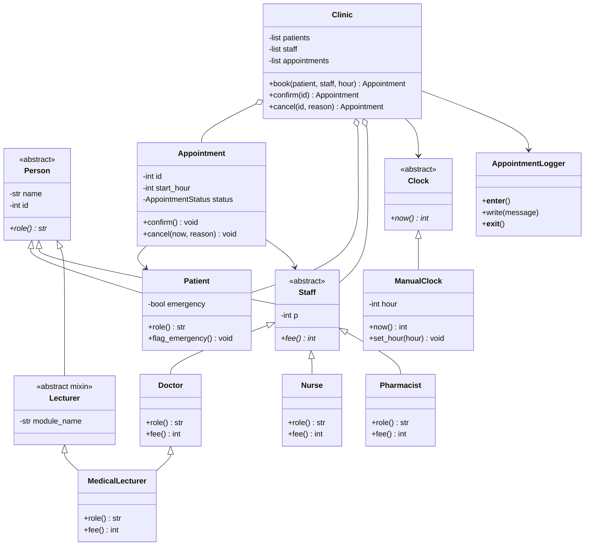

# Clinic Appointment System — Mini Project
# Aaron William R2420445
# Trinity Gwenzi R2420450
## Python and P value is nine

This project is implemented in **Python**. The selected value is `P = 9`.

- `9 mod 4 = 1`, therefore the required twist is **Emergency booking**.
- `9 mod 5 = 4`, so a doctor's fee is `40 + 5(4) = 60`.
- `9 mod 3 = 0`, so a nurse's fee is `10 + 0 = 10`.
- A pharmacist's fee is always `5`.

## Files

- `clinic.py` — all classes, rules, logging, and the demonstration in `main()`.
- `README.md` — this explanation, class diagram, design decisions, and run instructions.
- `appointment.log` — created automatically when the program runs.

## How to run

Python 3.8 or later is recommended. No other special packages are needed.

```bash
python clinic.py
```

The program uses `ManualClock(5)` in the demonstration. It does not read the computer's clock. The log file is created in the current working directory.

## Class diagram



## Explanation of the programming concepts

### 1. Classes, abstraction, and inheritance

`Person` is an abstract base class. It contains the common `name` and `id` fields and requires subclasses to implement `role()`.

`Patient` and `Staff` inherit from `Person`. `Staff` is also abstract because every kind of staff member must implement `fee()`.

`Doctor`, `Nurse`, and `Pharmacist` inherit from `Staff`. They each provide their own fee calculation and role.

`Appointment` represents one booking. `Clinic` manages patients, staff, appointments, and the booking rules.

### 2. Encapsulation, validation, and appointment states

Fields are stored using double-underscore attributes such as `__name`, `__id`, and `__status`. Python applies name-mangling to these attributes, making accidental external access harder (Python does not provide absolute private access control). Read-only properties expose selected values. The Clinic keeps its lists in double-underscore attributes and returns tuples from collection properties, not the internal lists.

Constructors reject blank names and ids that are not positive whole numbers. Appointment start hours must be whole numbers from 0 to 168.

The legal appointment status transitions are:

```text
PENDING ------> CONFIRMED
   |
   +----------> CANCELLED

CONFIRMED ----> CANCELLED

CANCELLED ----> no further transition
```

The `confirm()` and `cancel()` methods enforce these transitions. A confirmed appointment cannot be cancelled if fewer than two hours remain before its start. No appointment can be cancelled at or after its start hour. A cancelled appointment is terminal and cannot be confirmed or cancelled again.

### 3. Polymorphism

The Clinic prints staff fees using one loop:

```python
for staff_member in self._staff:
    print(staff_member.role(), staff_member.fee())
```

The loop does not ask whether an object is a Doctor, Nurse, or Pharmacist. Each object supplies its own `role()` and `fee()` implementation. To add another staff subclass, implement those methods and register an instance; the loop does not need to change.

### 4. Logging and exception handling

`AppointmentLogger` is a context manager. The Clinic is used with a `with` statement:

```python
with Clinic(clock, "appointment.log") as clinic:
    # Clinic operations
```

The context manager opens the log once on entry and closes it once on exit, including when an exception occurs. The `finally` block makes sure the file close is attempted.

`Clinic._perform()` logs successful actions and also logs failed actions before re-raising the original error. The demonstration deliberately attempts to book against a confirmed appointment and deliberately attempts a late cancellation, so failure records can be seen in `appointment.log`.

If opening the log fails, the Clinic cannot start its session. If writing fails, a `LoggingError` is raised. On exit, closing is still attempted. If the log itself cannot record a failure, the system cannot guarantee that the failure appears in the file; it must report the logging problem rather than pretend it was recorded.

### 5. Multiple inheritance and one Person initialization

`MedicalLecturer` inherits from both `Doctor` and `Lecturer`. Python's method resolution order (MRO) and cooperative `super()` calls create one initialization chain:

```text
MedicalLecturer -> Doctor -> Staff -> Lecturer -> Person
```

The `Person` constructor therefore runs once. The program resets and prints a constructor counter to demonstrate this.

`MedicalLecturer.fee()` uses the Doctor implementation. A medical lecturer is also a doctor, so the doctor's fee rule applies. There is no separate lecturer fee in the assignment.

In Java, `Lecturer` would be an interface because Java does not allow a class to extend both `Doctor` and `Lecturer`. `MedicalLecturer` could extend `Doctor` and implement `Lecturer`, keeping one `Person` base class through `Doctor`.

### 6. Clinic rules and the emergency twist

The Clinic checks that patients and staff are registered, and that their IDs are unique. Appointment IDs are allocated from the same used-ID set, so appointment IDs cannot collide with registered person IDs or other appointment IDs.

Before booking, the Clinic checks for another non-cancelled appointment for the same patient at the requested hour and for another non-cancelled appointment for the same staff member at that hour.

Because `P mod 4 = 1`, an emergency patient may replace a `PENDING` appointment for the same staff member and hour. The old appointment is cancelled with reason `"bumped"` and the new appointment is created as `PENDING`. A `CONFIRMED` appointment is never bumped. If the staff member has a confirmed appointment at that hour, the emergency booking fails and is logged.

### 7. Design decision log

**D1 — Where does the two-hour cancellation rule live?**

It lives in `Appointment.cancel()`. The rule concerns whether one appointment is allowed to change its own state. Putting it in `Clinic` would mean every caller would have to remember to apply the rule. A separate policy object would be useful if many different cancellation policies were required, but it would add complexity for this small project. The Clinic still controls and logs the cancellation operation.

**D2 — Why is the clock testable?**

The Clinic receives a `Clock` object and asks it for `now()`. In the demo, `ManualClock` can be moved to any hour. This makes boundary cases, such as exactly two hours before an appointment, repeatable. If the code read the computer's system time directly, tests would depend on when they were run and could not reliably set the time.

**D3 — What changed when Pharmacist was added?**

A `Pharmacist` subclass was added with its own `role()` and `fee()` methods. The staff-fee loop did not change because it uses polymorphism. If a special Pharmacist check had been added to the loop or Clinic, that would be a type-dependent design leak.

**D4 — What should `MedicalLecturer.fee()` return, and how is Person created once?**

It returns the Doctor fee because `MedicalLecturer` is a Doctor as well as a Lecturer. Python's cooperative `super()` and method resolution order (MRO) ensure that `Person.__init__()` is called once. Without a cooperative initialization chain, both parent paths could initialize the shared base separately or overwrite its state.

**D5 — What if writing to or closing the log fails?**

The program raises `LoggingError` rather than claiming that an action was successfully logged. The context manager uses `finally` to attempt to close the file even after a write failure. If the storage device or operating system refuses the close operation, software cannot guarantee a successful physical close; it can only make the attempt and report the error.

**D6 — Why can an emergency booking not bump a confirmed appointment?**

A confirmed appointment has already been accepted by the clinic and patient. The emergency rule specifically permits bumping a pending appointment, not a confirmed one. The Clinic rejects and logs an emergency booking when the conflicting appointment is confirmed.

### 8. Demonstration plan 

1. Running `python clinic.py` and showing that the selected `P` is 9 and `P mod 4` is 1.
2. Showing the `MedicalLecturer` constructor counter equals 1.
3. Showing the Doctor, Nurse, Pharmacist, and MedicalLecturer fees printed by one polymorphic loop.
4. Booking a normal pending appointment, then booking an emergency patient at the same staff member and hour. Showing the first appointment becomes `CANCELLED` with reason `bumped`.
5. Confirming another appointment and attempt to bump it. Showing that the booking fails.
6. Attempt to cancel a confirmed appointment with less than two hours' notice. Showing that it fails.
7. Open `appointment.log` and show successful and failed action records, plus `[log] opened` and `[log] closed`.

### Suggested unseen change request for practice

A likely live change request can be: Add a rule that appointments cannot be booked in the past.

A suitable place is inside `Clinic.book()`, using the injected clock:

```python
if start_hour < self._clock.now():
    raise BookingError("Cannot book an appointment in the past.")
```

This uses the existing Clock abstraction and does not require reading the computer's time.
